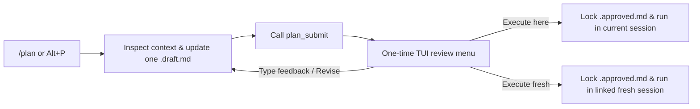

# Pi Plan Mode

**Review goals and acceptance criteria before Pi executes your task.**

English | [简体中文](./README.zh-CN.md)

[](https://pi.dev)
[](./LICENSE)
[](./CHANGELOG.md)

`pi-plan-mode` adds an acceptance-first `/plan` workflow to [Pi](https://github.com/earendil-works/pi). It helps you align on goals, verification criteria, and assumptions before the agent changes your files. It works for code, documentation, research, and operations tasks.

```text
────────────────────────────────────────────────────────────────────
Approve this plan? Esc closes

→ Execute in current session
  Execute in fresh session
  Revise: Type revision notes, or press Enter

↑↓ select · enter confirm · type to revise · esc close
────────────────────────────────────────────────────────────────────
```

---

## Why This Extension Exists

Pi skips built-in plan mode by default so users can install a workflow that fits their habits. Existing Pi plan packages focus on code-only planning, complex Bash allowlists, or shared mutable plan files.

`pi-plan-mode` takes a smaller and stricter path:

| Design Choice | What `pi-plan-mode` Does | Why It Matters |
| --- | --- | --- |
| **Acceptance-first format** | Uses a 5-section plan covering goals, acceptance criteria, execution, assumptions, and deliverables. | You review what success looks like, not only a list of files to edit. |
| **One draft, immutable approvals** | Updates one `.draft.md` file during planning, and saves a separate `.approved.md` snapshot upon approval. | Hand edits or later draft changes never alter an approved execution version. |
| **Inline review feedback** | Lets you type revision notes directly inside the approval menu. Unsent text disables approval buttons. | You cannot accidentally approve an old plan while typing feedback. |
| **No duplicate context on handoff** | Sends full plan text only when the current session context does not already contain those exact bytes. | Same-session execution does not waste tokens loading the same plan twice. |
| **Minimal tool boundary** | Blocks only `edit` and `write` outside the current draft, including nested calls inside `codemode`. | Your existing Bash, MCP, web, and permission extensions keep working without conflict. |

---

## How It Works



1. **Enter planning:** Run `/plan <task>`, `/plan start`, or press `Alt+P`.
2. **Explore and clarify:** The agent inspects the workspace and uses `ask_user_question` when available. `edit` and `write` can only modify the current draft file.
3. **Submit for review:** The agent writes or edits one `.draft.md` file and calls `plan_submit` as its final action.
4. **Review and decide:** After the turn settles, Pi opens the approval menu once. Choose current-session execution, fresh-session execution, or inline revision.

---

## Install

Requires **Pi 1.5.0 or newer**. The SDK baseline is `1.5.0`, and terminal menus are verified on `1.5.0` and `1.5.2`.

Install from GitHub:

```sh
pi install git:github.com/henrywen98/pi-plan-mode
```

Or install from a local clone:

```sh
pi install /absolute/path/to/pi-plan-mode
```

Run `/reload` in Pi, or restart Pi. Do not load another extension that registers `/plan` or `plan_submit` at the same time.

---

## Usage

```text
/plan start            Enter plan mode without sending a model request
/plan <task>           Enter plan mode and send the task prompt
/plan                  Open the menu for the current state
/plan show             Display the current draft or retained approved plan
/plan implement        Show the plan and confirm execution in the current session
/plan fresh            Show the plan and confirm execution in a linked fresh session
/plan export plan.md   Export the plan without overwriting existing files
/plan exit             Leave plan mode, keep plan files, and do not execute
```

### Approval Menu Actions

When the model submits a complete plan and the turn ends, the extension opens the review menu once:

- **Execute in current session:** Keeps your exploration chat and executes the approved snapshot.
- **Execute in fresh session:** Creates a linked session and transfers only the approved plan. You can still resume the original session.
- **Revise:** Type revision notes on the same line and press Enter to send them. Press Enter on an empty line to return to chat.

Start typing anywhere in the terminal menu to jump straight to the revision input. When the input contains unsent text, the menu disables execution options so you do not approve an outdated plan. Press `Esc` or `Ctrl+C` to close the menu and discard unsent text.

Single-line input replaces line breaks with spaces when you paste text. For multi-line feedback, press Enter on an empty revision line and type in the main chat box. RPC mode uses the standard selection dialog.

### Execution Safeguards

- Replying "OK" or "continue" in chat does not approve a plan. Sending a chat message after submission disables the previous approval entry until the agent submits again.
- Fresh sessions keep the current model, thinking level, working directory, and project rules. If the new session cannot match the runtime environment, execution does not start.
- For current-session execution, the extension leaves plan mode only after the execution turn actually starts. If handoff fails before start, run `/plan implement` or `/plan fresh` to review and approve again.
- Fresh-session handoff keeps the plan reviewable in the parent session so you can retry if handoff fails.

---

## Five-Section Plan Format

Plans use Markdown with a clear task title and five sections (written in the user's conversation language):

1. **Goals and Scope:** Who needs what outcome, and what is in or out of scope.
2. **Acceptance Criteria and Verification:** Expected results, how to check them, and required evidence.
3. **Execution Plan:** Actions, phases, and dependencies mapped to acceptance items.
4. **Assumptions and Stop Conditions:** Unverified conditions and what to do if they fail.
5. **Deliverables and References:** Output locations and materials needed for handoff.

This structure guides the model's writing; the extension validates submission state, non-empty Markdown, and the 50,000-byte limit rather than enforcing heading names mechanically.

During execution, the agent may adjust its method. If scope, acceptance criteria, or key assumptions change, the handoff prompt instructs the agent to pause and confirm with you first.

---

## Plan Files, Recovery, and Context Deduplication

Plan files live in `<agent-dir>/plans/` (usually `~/.pi/agent/plans/`).

- **Single mutable draft:** The first `plan_submit({ plan: "..." })` creates a `.draft.md` file. Later revisions use `edit` or `write` on that same file and call `plan_submit({})`.
- **Manual edits supported:** You can edit the `.draft.md` file in your own editor. Approval re-reads the file from disk and cancels approval if the file changed after display.
- **Immutable approved snapshot:** Approval creates a separate `.approved.md` file with a SHA-256 digest. Later draft edits do not change the approved execution snapshot.
- **Branch-aware state:** Plan state belongs to the current session branch. If the disk draft no longer matches the branch record after a session switch or tree move, old approvals are disabled until you re-submit.
- **Smart handoff projection:** Raw session history keeps the full approved plan. When the exact approved plan already appears earlier in context, the extension sends only a short authorization header. Fresh sessions have no prior context and receive the full plan once.

The extension never deletes plan files automatically. Clean up old files in `~/.pi/agent/plans/` when you no longer need them.

---

## Tool Boundaries

While plan mode is active, `edit` and `write` can only modify the current `.draft.md` file. This check also applies to nested tool calls inside `codemode`. Symbolic links and hard links cannot bypass this check. Before the first submission creates a draft, all `edit` and `write` calls are blocked.

`codemode`, `bash`, web tools, MCP tools, and subagents keep their existing permissions. This extension is a workflow gate, not an operating-system sandbox.

Press `Alt+P` to toggle plan mode. Exiting plan mode does not approve execution.

---

## Verification and Testing

Run the test suite locally without model API calls:

```sh
npm ci --ignore-scripts
npm run check
npm test
npm run test:e2e
```

- **Unit tests (`npm test`):** Verify file safety, input boundaries, handoff deduplication, and branch state.
- **SDK integration tests:** Run against real Pi and native `codemode` with deterministic local tools.
- **Terminal E2E tests (`npm run test:e2e`):** Drive the real Pi TUI menu through a PTY (requires Linux or macOS, Python 3, and Node.js).

To test compatibility with your installed question or footer extensions:

```sh
PLAN_TEST_ASK_EXTENSION=/path/to/question/index.ts \
PLAN_TEST_FOOTER_EXTENSION=/path/to/footer/index.ts \
npm run test:e2e
```

---

## Uninstall

Remove the package using the same source you used to install it:

```sh
pi remove git:github.com/henrywen98/pi-plan-mode
# Or for a local install:
pi remove /absolute/path/to/pi-plan-mode
```

Then run `/reload` in Pi. Existing plan files in `~/.pi/agent/plans/` are preserved.

---

## Credits and License

Independent implementation licensed under [Apache-2.0](./LICENSE).

Workflow design informed by OpenAI Codex, OpenCode, Claude Code, GitHub Spec Kit, and existing Pi plan-mode extensions (`@narumitw/pi-plan-mode`, `@nredd/pi-plan-mode`, and `@hank-warren/pi-plan-mode`). See [NOTICE](./NOTICE) for reference versions and scope. No upstream source files are bundled.
