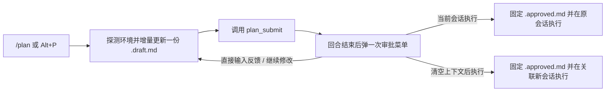

# Pi Plan Mode

**先审目标和验收标准，再批准执行。支持代码、文档、调研及其他任务。**

[English](https://github.com/henrywen98/pi-plan-mode/blob/main/README.md) | 简体中文

[](https://www.npmjs.com/package/@henrywen98/pi-plan-mode)
[](https://pi.dev/packages/@henrywen98/pi-plan-mode)
[](https://github.com/henrywen98/pi-plan-mode/actions/workflows/ci.yml)
[](https://pi.dev)
[](../LICENSE)

`pi-plan-mode` 为 [Pi](https://github.com/earendil-works/pi) 提供以验收标准为先的 `/plan` 规划与审批流程。模型改动业务文件前，你可以先确认目标、验收标准和关键假设。计划正文自动跟随你的对话语言（中文或英文）。

```text
────────────────────────────────────────────────────────────────────
Approve this plan? Esc closes

→ Execute in current session
  Execute in fresh session
  Revise: Type revision notes, or press Enter

↑↓ select · enter confirm · type to revise · esc close
────────────────────────────────────────────────────────────────────
```

---

## 为什么做这个扩展

Pi 默认不内置规划模式，留给用户按工作流安装扩展。同类规划扩展大多只面向写代码、维护复杂的 Bash 白名单，或让规划和执行共用同一份可变文件。

`pi-plan-mode` 选择了边界更小、版本更严的做法：

| 设计点 | `pi-plan-mode` 的做法 | 解决什么问题 |
| --- | --- | --- |
| **验收优先的五节格式** | 先写目标与范围、验收标准与验证，再写执行方案、假设与交付物。 | 审阅时先看怎样算做完，而不只看改哪些文件。 |
| **单份草稿 + 只读批准快照** | 规划期始终修改同一个 `.draft.md`；批准时另存独立的 `.approved.md` 快照。 | 手工改草稿或后续继续规划，不会篡改正在执行的批准版本。 |
| **审批菜单内直接打字提意见** | 菜单内直接输入修改要求；只要有未发送文字，执行选项自动停用。 | 防止一边打字提修改意见、一边误触回车批准旧计划。 |
| **交接不重复塞入计划全文** | 原会话上下文已有字节一致的批准正文时，交接只发授权和版本头。 | 避免原会话执行时把同一份计划重复加载进上下文。 |
| **最小工具拦截边界** | 只拦截当前草稿以外的 `edit` 和 `write`（含 `codemode` 嵌套调用）。 | 不改动原有 Bash、MCP、网页工具和权限扩展。 |

---

## 工作流程



---

## 安装

需要 Pi 1.5.0 或更高版本。SDK 回归基线是 1.5.0，终端交互已在 1.5.0 和 1.5.2 验证，其他版本不作兼容保证。

从 npm 安装（推荐）：

```sh
pi install npm:@henrywen98/pi-plan-mode
```

也可以从 GitHub 仓库或本地克隆安装：

```sh
pi install git:github.com/henrywen98/pi-plan-mode
pi install /absolute/path/to/pi-plan-mode
```

在 Pi 中执行 `/reload`，或重新启动 Pi。不要同时加载另一个占用 `/plan` 或 `plan_submit` 的插件。

---

## 使用

```text
/plan start            进入规划，不发送模型请求
/plan 先规划这个任务   进入规划并发送任务
/plan                  打开当前状态对应的菜单
/plan show             查看当前或保留的计划
/plan implement        展示计划，再确认原会话执行
/plan fresh            展示计划，再确认关联新会话执行
/plan export plan.md   导出，不覆盖现有文件
/plan exit             退出规划，保留文件，不执行
```

模型提交完整计划后，插件等待本轮结束，再弹一次审批菜单：

- **Execute in current session（当前会话执行）**：保留调查聊天，按批准版本执行。
- **Execute in fresh session（清空上下文后执行）**：新建关联会话，只转交批准计划；旧会话仍可恢复。
- **Revise（继续修改）**：选中后可在同一行输入修改要求。空着按回车仅返回聊天；有内容时按回车发送要求，模型修改同一份当前计划，再提交文件审阅。

终端菜单内直接打字也会转到修改要求输入框。有未发送文字时，不会批准旧计划；先发送或清空文字，才能选择执行。Esc 或 Ctrl+C 关闭菜单并放弃未发送文字。单行输入会把粘贴内容中的换行换成空格；需要保留多行格式时，可空着回车后在聊天框输入。RPC 仍使用原有选择菜单。

聊天中的“可以”不是批准。提交后继续发消息讨论，会暂时停用旧版审批入口。

新会话保持当前模型、思考级别和工作目录。它正常加载适用的项目规则。环境无法保持一致时，不启动执行。

批准原会话执行时，插件等对应执行回合启动后才退出规划。启动前交接失败时，计划仍可通过 `/plan implement` 或 `/plan fresh` 重新审阅和批准，不会自动重试。

新会话交接保留原会话的可审批计划，失败后可以返回重试；成功后也保留。返回原会话不会自动执行，再次批准表示再次发出执行请求。

---

## 计划格式

计划使用 Markdown，先写能识别任务的标题，再按五节组织：

1. **目标与范围**：谁需要什么结果，本次做到哪里。
2. **验收标准与验证**：预期结果、检查方法和证据。
3. **执行方案**：按行为或阶段说明做法及依赖。
4. **假设与停点**：重要未证实条件，以及不成立时怎么办。
5. **交付物与参考**：产物、位置和接手所需材料。

这是写作要求，不是标题检测器。插件只校验提交状态、内容有效性和大小，不判断计划是否考虑周全。

模型自行判断何时使用现有 `ask_user_question`。没有可用问卷时，在对话中提问。插件不注册第二套问卷。

执行方法可以调整。范围、验收标准或关键假设变化时，提示要求模型先暂停确认。无法验证的项目必须说明，不能自行降低完成标准。

---

## 文件和恢复

计划存放在 Pi 用户目录的 `plans/`，通常是 `~/.pi/agent/plans/`。

- 首次提交创建当前 `.draft.md` 文件。后续修订、退出后重新进入规划，都沿用它，不因一次反馈另建草稿。
- 首次用 `plan_submit({plan: "完整 Markdown"})` 建立文件。之后可用 edit 修改片段，或用 write 完整改写，再用 `plan_submit({})` 提交当前文件审阅；也兼容用 plan 参数替换同一文件的全文。
- 同一任务继续修改原文。明确换了任务时，改写当前文件并清理旧任务内容。查看和导出始终优先当前草稿，不因退出规划切回旧批准记录。
- 可以手工编辑草稿。审批重新读取文件；审阅后内容变化会取消本次批准。
- 批准创建独立 `.approved.md` 快照，仅用于固定执行版本和恢复，不是另一份需要维护的计划。后续修改草稿不改变执行版本。
- 退出、恢复、重载和切换会话不会自动删除文件或启动执行。旧版本创建的文件不会被批量迁移或删除，继续使用状态中记录的当前草稿。
- 状态属于当前历史分支，但切换历史不会回滚磁盘上的草稿。若草稿与恢复节点记录的内容不一致，旧审批会停用；检查当前文件并重新提交后才能审批。切换分支也会关闭旧菜单。
- 没有定时清理。请在不再需要恢复这些计划时手动清理文件。

原始会话记录保留完整批准正文。实际发送给模型前，插件检查前文是否已有字节一致的完整批准稿：已有时，交接只保留执行授权、版本和约束；没有或无法确定时，保留一次全文。新会话没有旧正文，因此保留全文。摘要、路径、旧稿加修改片段不算完整批准稿。

只精简插件自己记录的交接消息，不删除历史，不改其他用户消息或工具结果。用户重复粘贴、旧交接缺少来源记录、格式未知等情况不做省略。因此原始 HTML 导出仍可能有完整交接稿；它不等同于实际模型输入。每次请求重新检查，不依赖“以前发过”的标记。

不要求模型立即重读计划或计算哈希。批准快照路径和摘要值只作恢复信息：压缩等原因使正文不在上下文时，才按需读取。交接本身也被压缩移除后，不自动把旧批准稿注入所有未来请求。项目规则和事实来源仍按需读取。插件不持续安排或自动重试工作。

此处理在普通 context 过滤之后运行。若其他扩展随后删改计划正文，需要重新验证实际模型输入，不能仅凭界面或历史记录判断兼容。

---

## 工具边界

规划时，精确工具名 `edit` 和 `write` 只允许修改当前草稿，包括 codemode 的嵌套调用。批准快照、其他草稿和业务文件不在例外范围内；符号链接或硬链接也不能借当前草稿路径修改其他文件。首次提交前尚无草稿，edit/write 均被拦截。

`codemode`、Bash、网页、MCP 和子代理不增加限制。插件不改变原有工具列表，也不覆盖原有权限。

这不是只读沙箱。其他工具仍可能写入；不要通过这些工具提前实施。批准计划也不解除工作区已有规则。

`Alt+P` 切换规划模式；退出不等于批准执行。插件只发布自己的 footer 状态，不替换 footer，不修改模型默认配置。

---

## 验证

```sh
npm ci --ignore-scripts
npm run check
npm test
npm run test:e2e
```

- 单元测试检查文件、输入边界和分支状态。
- SDK 集成测试使用真实 Pi、原生 codemode 和本地模拟工具。
- 终端测试通过 PTY 操作真实 Pi 菜单，覆盖取消、原会话执行、新会话执行和重载。
- 测试提供确定性响应，不连接模型服务。

终端测试需要 Linux/macOS、Python 3 和 Node.js。要回归已经安装的问答或 footer 扩展，传入路径：

```sh
PLAN_TEST_ASK_EXTENSION=/path/to/question/index.ts \
PLAN_TEST_FOOTER_EXTENSION=/path/to/footer/index.ts \
npm run test:e2e
```

`PLAN_TEST_ARTIFACT_DIR` 可指定本地终端记录目录。`PLAN_TEST_CLI` 可指定另一份 Pi 的 `dist/cli.js`，用于跨宿主版本测试。实际会话、生成计划和验收报告不得提交。

非交互模式可正常使用其他工具，也可以显式进入规划；本版本不支持非交互审批。

---

## 卸载

使用安装时的相同来源：

```sh
pi remove npm:@henrywen98/pi-plan-mode
# GitHub 或本地安装则用：
pi remove git:github.com/henrywen98/pi-plan-mode
pi remove /absolute/path/to/pi-plan-mode
```

随后执行 `/reload`。计划文件保留，其他配置不变。

---

## 来源与许可证

独立实现，采用 Apache-2.0。流程参考 Codex、OpenCode、Claude Code 及现有 Pi 规划插件。

参考版本和具体借鉴范围见 [NOTICE](../NOTICE)。没有打包上游实现源码。
